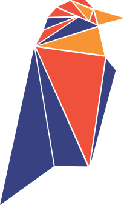

2Miners netstats client
=======================

Node-side reporter for the 2Miners network stats pages. It runs next to a node, reads it over the node's own RPC and pushes blocks, peers, mempool and network stats over WebSockets (Primus protocol) to the 2Miners netstats server.

## Networks

| | Network | Stats page | `CHAIN` | Example |
|---|---|---|---|---|
|  | **Ethereum Classic** (ETC) | [2miners.com/etc-stats](https://2miners.com/etc-stats/) | `eth` | [examples/etc.env](examples/etc.env) |
|  | **EthereumPoW** (ETHW) | [2miners.com/ethw-stats](https://2miners.com/ethw-stats/) | `eth` | [examples/ethw.env](examples/ethw.env) |
|  | **Ravencoin** (RVN) | [2miners.com/rvn-stats](https://2miners.com/rvn-stats/) | `btc` | [examples/rvn.env](examples/rvn.env) |
|  | **Bitcoin** (BTC) | [2miners.com/btc-stats](https://2miners.com/btc-stats/) | `btc` | [examples/btc.env](examples/btc.env) |
|  | **Bitcoin Cash** (BCH) | [2miners.com/bch-stats](https://2miners.com/bch-stats/) | `btc` | [examples/bch.env](examples/bch.env) |
|  | **Neurai** (XNA) | [2miners.com/xna-stats](https://2miners.com/xna-stats/) | `btc` | [examples/xna.env](examples/xna.env) |
|  | **Nexa** (NEXA) | [2miners.com/nexa-stats](https://2miners.com/nexa-stats/) | `btc` | [examples/nexa.env](examples/nexa.env) |
|  | **Pearl** (PRL) | [2miners.com/prl-stats](https://2miners.com/prl-stats/) | `btc` | [examples/prl.env](examples/prl.env) |
|  | **Zcash** (ZEC) | [2miners.com/zec-stats](https://2miners.com/zec-stats/) | `btc` | [examples/zec.env](examples/zec.env) |
|  | **Zephyr** (ZEPH) | [2miners.com/zeph-stats](https://2miners.com/zeph-stats/) | `monero` | [examples/zeph.env](examples/zeph.env) |
|  | **Ergo** (ERG) | [2miners.com/erg-stats](https://2miners.com/erg-stats/) | `ergo` | [examples/erg.env](examples/erg.env) |
|  | **Nervos CKB** (CKB) | [2miners.com/ckb-stats](https://2miners.com/ckb-stats/) | `ckb` | [examples/ckb.env](examples/ckb.env) |
|  | **Beam** (BEAM) | [2miners.com/beam-stats](https://2miners.com/beam-stats/) | `beam` | [examples/beam.env](examples/beam.env) |
|  | **Grin** (GRIN) | [2miners.com/grin-stats](https://2miners.com/grin-stats/) | `grin` | [examples/grin.env](examples/grin.env) |
|  | **MimbleWimbleCoin** (MWC) | [2miners.com/mwc-stats](https://2miners.com/mwc-stats/) | `grin` | [examples/mwc.env](examples/mwc.env) |
|  | **Aeternity** (AE) | [2miners.com/ae-stats](https://2miners.com/ae-stats/) | `ae` | [examples/ae.env](examples/ae.env) |
|  | **Quantus** (QTC) | [2miners.com/qtc-stats](https://2miners.com/qtc-stats/) | `substrate` | [examples/qtc.env](examples/qtc.env) |
|  | **Quai** (QUAI) | [2miners.com/quai-stats](https://2miners.com/quai-stats/) | `quai` | [examples/quai.env](examples/quai.env) |
|  | **Kaspa** (KAS) | [2miners.com/kas-stats](https://2miners.com/kas-stats/) | `kaspa` | [examples/kas.env](examples/kas.env) |

How the node is read:

* **Ethereum family** (core-geth, geth): WebSocket JSON-RPC with `newHeads` / `newPendingTransactions` subscriptions.
* **Bitcoin forks** (`CHAIN=btc`): bitcoind-style HTTP JSON-RPC, polled; fees from `getblockstats` or the coinbase minus the block reward.
* **Others**: each node's own API, polled (monerod json_rpc, Ergo REST, CKB JSON-RPC, Beam explorer, Grin/MWC node API, Aeternity HTTP, Substrate, go-quai, rusty-kaspa gRPC).

A single static Go binary: no Node.js, npm or PM2.

## Requirements

* Ethereum: a node with the WebSocket RPC enabled, e.g. `--ws --ws.port 8546 --ws.origins '*' --ws.api admin,eth,net,web3,txpool` (the client needs `eth,net,web3`; HTTP RPC is not used)
* Bitcoin forks: the node's RPC (`rpcuser` / `rpcpassword`, `rpcallowip` for the client's address); no wallet needed
* Go 1.26+ to build, or a prebuilt linux amd64/arm64 binary

## Download

Prebuilt static binaries for linux amd64 and arm64 are on the [releases page](https://github.com/2miners/netstats-2m/releases):

```bash
curl -LO https://github.com/2miners/netstats-2m/releases/latest/download/SHA256SUMS
curl -LO https://github.com/2miners/netstats-2m/releases/download/v1.3.4/netstats-2m-v1.3.4-linux-amd64.tar.gz   # or -linux-arm64
sha256sum -c --ignore-missing SHA256SUMS
tar xzf netstats-2m-v1.3.4-linux-amd64.tar.gz
```

Each archive has the binary, `examples/` (an env file per network), the systemd unit, README and LICENSE.

## Build

```bash
git clone https://github.com/2miners/netstats-2m
cd netstats-2m
make build            # build/bin/netstats-2m (linux/amd64, static)
make release          # build/release: linux amd64 + arm64 archives and SHA256SUMS
```

## Configure

One env file per node; start from the network's file in [examples/](examples/):

| Var | Meaning |
|---|---|
| `WS_HOST`, `WS_PORT` | node WebSocket RPC, i.e. the `--ws.port` (default `localhost:8546`). `RPC_HOST`, `RPC_PORT` are accepted as the same setting (old JS client names); `WS_*` wins |
| `CHAIN` | `eth` (default) or `btc` for Bitcoin forks |
| `RPC_HOST`, `RPC_PORT`, `RPC_USER`, `RPC_PASSWORD` | `CHAIN=btc`: node HTTP RPC (default `localhost:8766`, the ravend port) and its `rpcuser` / `rpcpassword` |
| `SUBSIDY_START`, `SUBSIDY_HALVING` | `CHAIN=btc`: block reward at height 0 and the halving interval, so fees can be told from the reward in the coinbase (default Ravencoin: `5000`, `2100000`; Bitcoin: `50`, `210000`) |
| `CHAIN=monero`, `ergo`, `ckb`, `beam`, `grin`, `ae`, `substrate`, `quai`, `kaspa` | other node APIs, polled every `POLL_INTERVAL` (default `1s`): Zephyr (monerod json_rpc, `RPC_USER`/`RPC_PASSWORD` = rpc-login, digest auth), Ergo REST, Nervos CKB JSON-RPC, Beam explorer-node API, Grin/MWC node API v2 (`RPC_USER` `grin`/`mwcmain`, `RPC_PASSWORD` foreign secret, `RPC_OWNER_PASSWORD` owner secret for peers and sync), Aeternity HTTP API, Substrate (Quantus: difficulty and time from storage), Quai zone chain with KawPoW, SHA256 and Scrypt difficulty, hashrate and share time from `quai_getMiningInfo`, Kaspa over its gRPC (own minimal client, no generated code; `POLL_INTERVAL=5s`, samples of the DAG sink numbered by DAA score, no history). `NODE_NAME` names the node on the page |
| `WS_SERVER` | netstats server: `wss://<network>-stats.2miners.com` (see the table above) |
| `WS_SECRET` | server secret: the value in the examples (public on purpose, any pool may report its node) |
| `INSTANCE_NAME` | name shown on the page; required with `NODE_ENV=production`. The node id on the server is its camelCase form |
| `CONTACT_DETAILS` | optional contact shown on the page |
| `LISTENING_PORT` | p2p port, display only |
| `VERBOSITY` | 0 errors, 1 + warnings, 2 + info, 3 everything |

Real environment variables override the file.

## Run with systemd

```bash
useradd --system --home-dir /opt/netstats-2m --shell /usr/sbin/nologin netstats-2m
install -d -o netstats-2m -g netstats-2m -m 0750 /opt/netstats-2m
install -m 0755 build/bin/netstats-2m /opt/netstats-2m/
install -o netstats-2m -m 0640 examples/ethw.env /opt/netstats-2m/ethw.env      # edit it
cp deploy/netstats-2m@.service /etc/systemd/system/
systemctl daemon-reload
systemctl enable --now netstats-2m@ethw
journalctl -u netstats-2m@ethw -f
```

Or by hand: `./netstats-2m -env ethw.env`.

## Behaviour

* One RPC connection to the node; while it is unreachable the client retries every 5 s and memory stays flat. Requests time out after 15 s, so a hung node is reported as down instead of piling up requests.
* The server connection starts after the first successful node connection and reconnects every 5 s (every minute after the server refused the secret).
* Wire-compatible with the old JS client: the same messages, node id and block format, so it can replace it without changes on the server.
